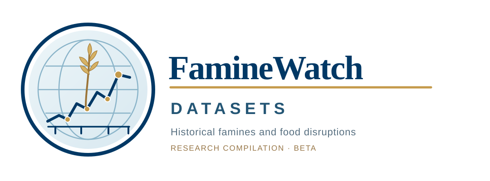

# FamineWatch Datasets (v0.2, beta)

A curated, citable compilation of documented famines and severe food-system disruptions, from historical literature and humanitarian assessments, **plus the regional famine-year chronology for medieval and early modern Europe (1250–1800)** used in recent climate–famine research.

**Explore it in your browser:** open [`docs/index.html`](docs/index.html) (or the GitHub Pages site once Pages is enabled for the `/docs` folder). The explorer has an interactive region × year famine heatmap for Europe, a global timeline, a searchable/filterable table with CSV/JSON download of any filtered subset, and the full source list and change log.

---

## What's in the repository

| File | Contents |
|---|---|
| `data/faminewatch_events.csv` / `.json` | **All records** (619): the beta compilation (381, corrected and flagged), v0.2 additions (2), and the European regional famine episodes (236). One row per event. |
| `data/europe_famine_episodes_1250-1800_LjungqvistEtAl2024.csv` | European famine episodes by region (236), as printed in Ljungqvist et al. (2024), Table A1, with regional sources and notes. |
| `data/europe_famine_region_year_1250-1800_LjungqvistEtAl2024.csv` | The same chronology as a long region × year table (9 regions × 551 years; `famine` = 1/0). |
| `data/europe_famine_region_year_wide_1250-1800_LjungqvistEtAl2024.csv` | Wide year × region 0/1 matrix — ready for time-series analysis. |
| `data/references.csv` | Full citations (corrected beta reference list + v0.2 sources). |
| `data/changelog_v0.2.csv` | Every correction applied in v0.2 (old → new value, reason) and every item flagged for review. |
| `famine_database_v0.2.xlsx` | All of the above as one workbook. |
| `famine_database_beta.xlsx` | The original beta workbook, kept unchanged for provenance. |
| `docs/index.html` | Self-contained interactive explorer (no server or install needed). |
| `scripts/` | `build.py` regenerates every file above from the beta workbook and `data/raw/`; `make_xlsx.py` builds the workbook. |

### Event table columns (`faminewatch_events.csv`)

| Column | Description |
|---|---|
| `event_id` | Stable ID. `FW-####` for compilation records (numbered chronologically); `LJ24-<region>-<start>` for European episodes. |
| `source_dataset` | Which compilation the record comes from. |
| `start_year`, `end_year` | Integer years; negative = BCE. |
| `year_label` | Period as written in the source. |
| `area` | Place as reported (country, province, city, or multi-region). |
| `macro_region` | Europe; South Asia; East Asia; Southeast Asia; Middle East & North Africa; Sub-Saharan Africa; Americas; Oceania; Multi-region / global. |
| `event_type` | Famine / food crisis · Famine (regional famine years) · Volcanic eruption (climate forcing) · Production shock (drought) · Climate anomaly. |
| `primary_cause`, `environmental_category` | Drivers as recorded in the beta compilation. |
| `description` | Impacts: mortality, crop losses, prices, displacement, quoted historical reports. |
| `references` | Short-form citations (full forms in `references.csv`). |
| `verification_status` | `as compiled (beta); not yet re-verified` · `corrected in v0.2` · `flagged for review` · `transcribed from published table (v0.2)` · `added in v0.2 (source-checked)`. |
| `qc_notes` | What was changed or why a record is flagged. |

---

## European famine chronology, 1250–1800

The European records are the regional famine-year list of **Ljungqvist, Seim & Collet (2024)**, Appendix Table A1, which revises and expands the lists of **Alfani & Ó Gráda (2017, 2018)**. Nine regions: Italy, Spain, France, Central Europe, the Low Countries, Great Britain, Ireland, the Nordic countries, and Russia/Ukraine.

* The list records **only the presence of famine conditions** in a region in a given year. It says nothing about severity or geographic extent within the region; for most pre-19th-century famines that information does not exist.
* Regional sources used by Ljungqvist et al. to revise each region are listed per episode (`regional_sources`) and in `references.csv`. Please cite them along with the chronology.
* The article is open access under CC BY 4.0; the table is redistributed here with attribution.

**Transcription and checks.** Table A1 was extracted from the published PDF using text positions. Checks: (1) the extracted sequence of 1,507 characters of year values matches the PDF text exactly; (2) Central Europe has 22 famine periods in 1500–1800, matching the count reported by Esmaili et al. (preprint); (3) years with famine in ≥ 4 regions match Ljungqvist et al.'s Table A2, apart from three discrepancies that are internal to the published tables (see below).

**Known issues in the published table (kept as printed, flagged):**
* Italy `1539–49` overlaps the separate Italy `1544–45` entry and may be a typesetting error for `1539–40`. Treated as printed, the 1500–1800 total is 161 regional episodes; merging the overlap gives 160.
* Table A2 (years with famine in ≥ 4 regions) lists 1556 (Table A1 gives only 3 regions that year) and omits 1629 and 1630 (Table A1 gives 4 regions each).
* Comma-separated years in one cell (Russia/Ukraine `1279, 1282`; `1468, 1472`; `1674, 1677`) are split into separate episodes.

---

## Corrections and flags in v0.2

Selected corrections (all in `changelog_v0.2.csv`):

* **Somalia 2010–12:** excess mortality was **258,000** (244,000–273,000), Oct 2010–Apr 2012 (Checchi & Robinson 2013); the beta had 0.285 million.
* **43 BCE eruption:** now attributed to **Okmok II (Alaska)**, early 43 BCE (McConnell et al. 2020), not Etna.
* **Eldgjá:** began in **939 CE** and continued to at least 940 (Oppenheimer et al. 2018), not 934.
* **Tarawera:** erupted on 10 June **1886**, not 1885.
* "Puma et al. (in press)" → **Puma, Chon & Wada (2015)**, *PAGES Magazine* 23(2), 66–67.
* Book titles on the Chinese famine were swapped (*Tombstone* is Yang 2012; *Mao's Great Famine* is Dikötter 2010); Robock (2000) and Jordan (1996) citations reconciled; encoding errors in the reference list fixed; a stray text fragment removed from the 1813 Poland entry; assorted typos.

Flagged for expert review, not changed (⚑ in the explorer): the Soviet famine of 1932–33 (beta excess mortality of 1.2 million is far below the literature range); Yemen (no formal IPC Famine classification); dates of the Ethiopian (1983–85), North Korean (1995–2000) and Henan (1942–43) famines; Kuwae attribution of the 1450s eruption; Agung VEI (4 vs 5); a duplicate 1586 England entry; two implausible Walford entries (1286–1308; 1594 text about the 1590 siege of Paris); and an unresolved Dando (1980/2012) citation.

**v0.2 additions:** Sudan 2024–present (IPC-confirmed Famine in Zamzam camp, El Fasher and Kadugli) and the Gaza Strip 2025 (IPC-confirmed Famine in Gaza Governorate).

## Known gaps (next steps)

* Walford (1878) Table 1 entries for **1832–1878** have not yet been transcribed.
* The original **Alfani & Ó Gráda database (1250–present)** is deposited at openICPSR (doi:10.3886/E120551V1) and would extend European coverage past 1800.
* Mortality figures are stored as text; numeric excess-mortality fields with low/high bounds would make the data easier to analyse.
* Severity and extent are absent for most records; IPC phase classifications could be added for post-2004 crises.

## Status and use

This is a **select compilation**, not an exhaustive global list. It is intended for **research, teaching, and method development** and **should not be used for operational early warning** without contextual validation.

## Citation

> Puma, M. J., & Chon, S. (2026). *FamineWatch Datasets: Compilation of Select Famines and Food Disruptions Around the World* (v0.2, beta). Center for Climate Systems Research, Columbia Climate School, Columbia University at NASA Goddard Institute for Space Studies. https://github.com/mjpuma/faminewatch-datasets

When using the European famine years, please also cite:

> Ljungqvist, F. C., Seim, A., & Collet, D. (2024). Famines in medieval and early modern Europe—Connecting climate and society. *WIREs Climate Change*, 15(1), e859. https://doi.org/10.1002/wcc.859
>
> Alfani, G., & Ó Gráda, C. (Eds.) (2017). *Famine in European History*. Cambridge University Press. https://doi.org/10.1017/9781316841235
>
> Alfani, G., & Ó Gráda, C. (2018). The timing and causes of famines in Europe. *Nature Sustainability*, 1, 283–288. https://doi.org/10.1038/s41893-018-0078-0

See also: Esmaili, E., Puma, M. J., Ludlow, F., et al. *El Niño amplified food insecurity in early modern Europe* (uses this chronology). Preprint: https://doi.org/10.21203/rs.3.rs-7812038/v1

## Contact

Contributions, corrections, and archival additions are welcome — open an issue or email **mjp38@columbia.edu**.
